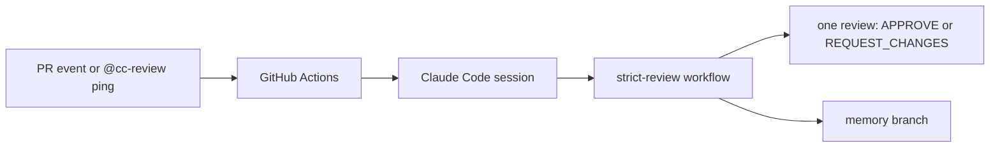

<div align="center">

# `cc-review`

**A pull request and merge request reviewer that runs Claude Code in GitHub Actions and posts as its own GitHub App.**

[](./LICENSE)
[](https://github.com/Questi0nM4rk/cc-review/actions/workflows/ci.yml)
[](https://github.com/Questi0nM4rk/cc-review/actions/workflows/ci.yml)

</div>

## Why it exists

Most automated reviewers either flag everything with no judgement or bill per token through an API key.
cc-review runs a real Claude Code session on a Claude subscription, and asks the model to review strictly: every finding is a required change, and the review approves only with zero findings and zero open threads.
It refuses to be a service, a hosted product or a replacement for a human reviewer.
It would have no reason to exist if a hosted reviewer gave the same strictness at no extra cost.

## See it on a real PR

[hook-kit #29](https://github.com/Questi0nM4rk/hook-kit/pull/29) and [hook-kit #33](https://github.com/Questi0nM4rk/hook-kit/pull/33) carry real cc-review threads.
On #29 it caught that a `mv` source counted only as a read, so a rule protecting `/etc` let `mv /etc/passwd /tmp/x` through, and that pipe stages ignored the configured global flags; both were fixed in the PR.
On #33 it caught that filtering a verify run down to zero checks reported success, and that `--base` could swallow the next flag as its value.

## Quickstart

The reviewer cannot run without these three things. There is no offline review mode.

- A Claude subscription and its OAuth token, stored as the secret `CLAUDE_CODE_OAUTH_TOKEN` (create it with `claude setup-token`).
- A GitHub App you own, with permissions Contents, Pull requests and Issues (read and write) and Metadata (read). It is the review identity. Store its client ID as the secret `REVIEWER_APP_CLIENT_ID` and its private key as `REVIEWER_APP_PRIVATE_KEY`.
- The App installed on the target repository and on this repository (the workflows clone this repository at run time).

Then copy the workflows into the target repository:

```bash
git clone https://github.com/Questi0nM4rk/cc-review && cd cc-review
./scripts/install-to-repo.sh /path/to/your-repo
```

Open a pull request in that repository, or comment `@cc-review` on one.
`./scripts/setup.sh` creates the App for you. Details, GitLab and troubleshooting are in [docs/guide.md](docs/guide.md).

Run the tests without any secret (Node 24):

```bash
npm test
# the summary reports `0 fail`
```

## How it works



A workflow file in the target repository starts a runner. The runner mints a GitHub App token, clones this repository, and drives an interactive Claude Code session through [coder/agentapi](https://github.com/coder/agentapi).
The session runs `strict-review.mjs`: a first review posts an overview with a difficulty from 1 to 5, and the difficulty sets how many reviewer agents run. A re-run checks its earlier comments against the code and resolves the ones that are fixed.

Deterministic: trigger and ignore rules, the difficulty-to-squad table, diff and thread fetching, the approval gate, secret scanning of run logs, and the post step.
Calls a model: the overview, every reviewer, the web research agents, the false-positive filter and the comment replies.

On GitLab the same engine runs locally with `scripts/run-gitlab.sh --mr <iid>` and posts as you.
The full contract is in [SPEC.md](SPEC.md).

## Numbers

[](https://github.com/Questi0nM4rk/cc-review/actions/workflows/ci.yml)

| What | How to measure |
| --- | --- |
| Tests | `npm test` (the badge counts only what `ci.yml` runs) |
| Test time | `time npm test` |
| Source size | `scc --no-cocomo scripts` |
| Review quality | Not measured |

Commits include agent-authored work under my identity; design, orchestration and review are mine.

## Status

- **Works:** GitHub review through the App on pull requests, `@cc-review` pings and labels, re-runs that resolve fixed threads, a per-project `.cc-review.yaml`, a local GitLab runner.
- **Experimental:** the learning memory. It stores notes per project on the `claude-reviewer/memory` branch and is a noise filter more than a learner ([docs/learning-loop-plan.md](docs/learning-loop-plan.md)).
- **Known gaps:**
  - It needs a Claude subscription and a GitHub App. There is no API-key mode.
  - Cost is not measured. A run uses a share of the subscription's weekly quota.
  - `ci.yml` runs a subset of `npm test`.
  - GitLab has no CI mode and posts under your account.
  - The memory branch lives in the repository that runs the bot. Use a private fork if you review private code.

Reference: [guide](docs/guide.md), [spec](SPEC.md), [GitHub review API notes](docs/github-review-api.md), [lessons learned](docs/lessons-learned.md).

## License

GPL-3.0. See [LICENSE](LICENSE).
