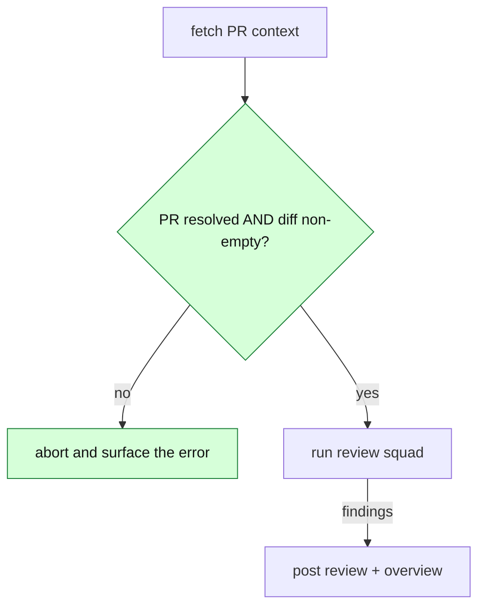
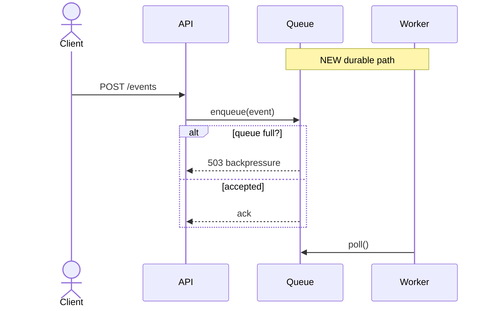
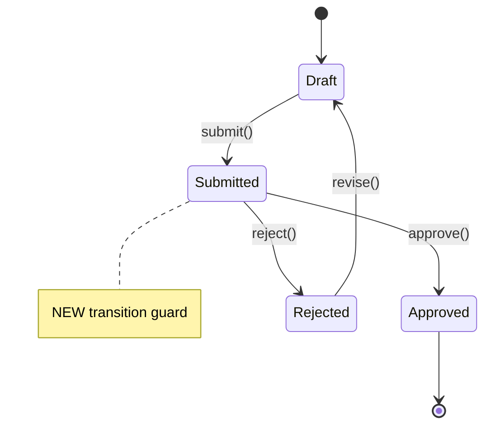
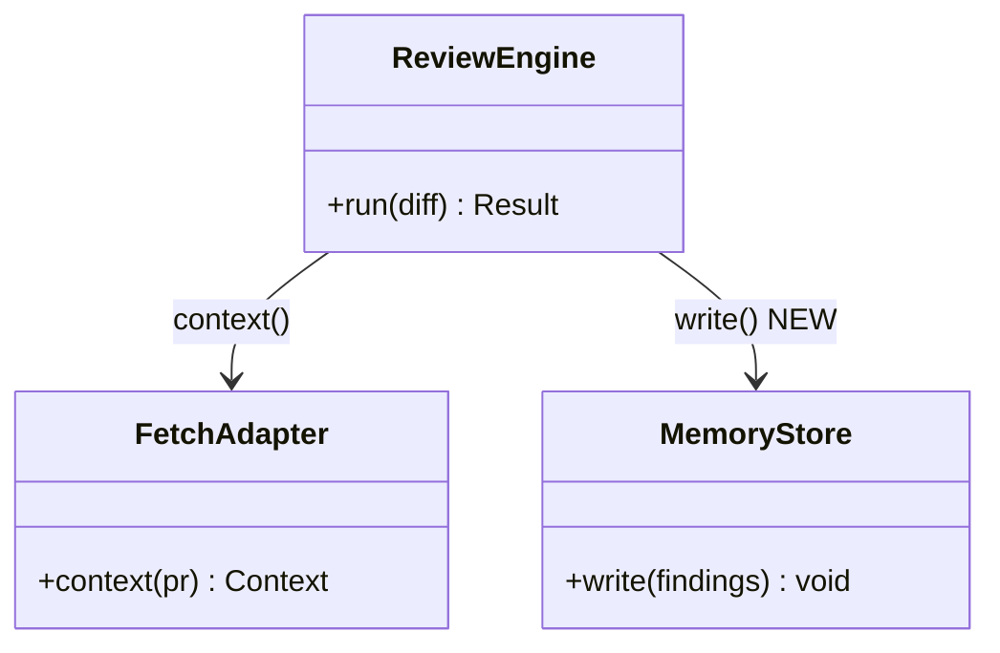
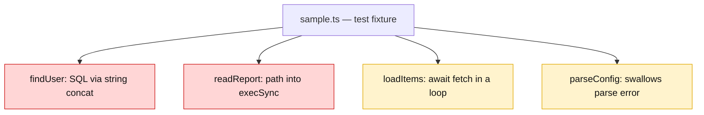

# Overview diagram — 1.0 production standard

The triage agent posts ONE overview comment per PR: a prose walkthrough + a single
```` ```mermaid ```` diagram of how the change works. The diagram is the PR overview —
**posted on PR-open, then edited in place** as the PR evolves (never re-posted; see the
overview-edit-in-place TODO in `CLAUDE.md`).

Tune the standard visually: `~/.claude/work/cc-review/overview-diagram-studio.html`
(open in a browser; it renders live and emits both the mermaid and this prompt block).

> **Every diagram and rule below was validated by rendering it through mermaid v11 in
> headless Chrome (the same engine GitHub uses) — not by eye.** The validation harness
> lives at `~/.claude/work/cc-review/diagram-validation/` (`gen.mjs` emits the cases,
> `mmdc` renders them to PNG). Re-run it before changing the label rules.

## The five rules

1. **Renders every time.** GitHub mermaid is strict and a block that fails to parse is
   worse than none. The render-safe rules are **per diagram type** — see the table below.
   The one universal hard parse-breaker: an **unquoted** flowchart node label containing
   `( ) [ ] { }`. Everything else is type-specific.
2. **Show CALLS and DECISIONS, never a static box list.** Label edges with the actual
   call/message (`enqueue(event)`, `context()`); render every branch/guard as a flowchart
   diamond `{"condition?"}` or a sequence `alt`/`else`/`opt` block. *(Maintainer-critical:
   a fan-out of changed symbols is a bullet list in disguise — show the flow.)*
3. **Type chosen for the change**, not defaulted:
   - `sequenceDiagram` — cross-component / async call flows
   - `flowchart` — branching / control-flow logic
   - `stateDiagram-v2` — lifecycle / state machines
   - `classDiagram` — type / structure changes
   - `erDiagram` — schema / data-model changes
   - If the change has no real flow (independent edits), prefer prose over a forced catalog.
4. **Emphasize what the PR changes.** Tag new/modified/risky nodes and style them —
   `classDef chg fill:#d6ffd9,stroke:#1a7f37,color:#111` (or `risk fill:#ffd6d6,stroke:#cc1111`)
   then `class <ids> chg`; in sequence diagrams use `Note over …: NEW`.
5. **5–12 nodes, one clear story.** Collapse incidental detail.

## Label syntax — quote rules differ BY TYPE (this is the part everyone gets wrong)

The single most common 1.0 mistake is applying flowchart's "quote everything" habit to a
sequence diagram, where it renders **literal quote marks**. Quoting is a flowchart
delimiter; in the other types it is just text.

| Diagram type | Where the label goes | Quote the label? | Parens / punctuation | Proven by |
|---|---|---|---|---|
| `flowchart` | node `A["…"]`, edge `A -->\|"…"\| B` | **YES** — quotes are delimiters, stripped on render | fine *inside* the quotes; `<br/>` gives a line break | `doc1-flowchart` renders clean; the unquoted-paren probe **fails to parse** |
| `sequenceDiagram` | message after `:` (`A->>B: text`) | **NO** — quotes render as literal `"` | fine bare: `API->>Q: enqueue(event)` | `doc2-QUOTED` shows `"…"`; `doc2-UNQUOTED` is clean |
| `stateDiagram-v2` | transition after `:` (`X --> Y: text`) | **NO** | fine bare: `Draft --> Submitted: submit()` | `studio-state` |
| `classDiagram` | method sig in `{}`, relation `A --> B : text` | **NO** | required for methods: `+run(diff) Result` | `studio-class` |

Corollaries (all render-verified):
- Inside a **quoted flowchart label**, `( ) < > # % & \| { } : ;` and a backtick all parse
  and render; `<br/>` is a line break. So you never need to mangle a flowchart label —
  just quote it. (Don't *rely* on raw `< > &` looking a specific way across every GitHub
  mermaid version; prefer plain words, use `<br/>` only for breaks.)
- A flowchart **diamond** is `D{"condition?"}` — the braces are the shape, the quotes
  protect the text. Both are required when the condition has spaces or punctuation.

## Prompt block (paste into `triagePrompt`, replacing the current diagram instruction)

```
DIAGRAM — inside overview_markdown, exactly one ```mermaid fenced block:
- Choose the type that fits THIS change, do not default blindly:
  sequenceDiagram (cross-component/async calls); flowchart (branching/control flow);
  stateDiagram-v2 (lifecycle/state); classDiagram (type/structure); erDiagram (schema).
  If the change has no real flow (independent edits), prefer prose over a forced catalog.
- Show CALLS and DECISIONS, never a static list of changed symbols: label edges with the
  actual call/message; render every branch/guard as a flowchart diamond {"condition?"} or
  a sequenceDiagram alt/else (or opt) block.
- Mark what the PR changes: tag new/modified hops and emphasize them with classDef
  (chg fill:#d6ffd9,stroke:#1a7f37; risk fill:#ffd6d6,stroke:#cc1111) + `class <ids> chg`,
  or in sequence diagrams a `Note over …: NEW`.
- RENDER-SAFE — GitHub is strict; a block that fails to parse is worse than none. Label
  quoting differs BY DIAGRAM TYPE — get this exactly right:
  * flowchart: wrap EVERY node label in double quotes — A["text"] — and every edge label —
    A -->|"text"| B. Quoted, the text may contain ( ) : ? . , / and <br/> for a line break.
    An UNQUOTED node label containing ( ) [ ] { } fails to parse.
  * sequenceDiagram / stateDiagram-v2 / classDiagram: write the message / transition /
    relationship label as PLAIN text after the colon — do NOT wrap it in quotes (quotes
    render as literal " characters). Parens are fine bare: API->>Q: enqueue(event).
  * Keep node/participant ids alphanumeric; prefer plain words over raw < > & #; use <br/>
    only for line breaks.
- Keep it to 12 nodes max, one clear story; collapse incidental detail.
- On a re-run, if an overview diagram already exists, EDIT IT IN PLACE to match the current
  code; do not post a second overview.
```

## Worked examples (every one render-verified on mermaid v11)

Flowchart with a decision diamond (a guard change) — node + edge labels quoted:



Sequence with labeled calls + an `alt` decision — messages are **bare** (no quotes), parens fine:



State machine (a lifecycle / transition-guard change) — transition labels bare:



Class diagram (a new collaborator / structure change) — method + relation labels bare:



The weak case — independent edits with no flow between them. A fan-out catalog *parses*,
but it is a bullet list wearing a diagram costume and adds little over prose. When a change
has no real flow, **lean on the prose and drop the diagram** rather than forcing this shape:


