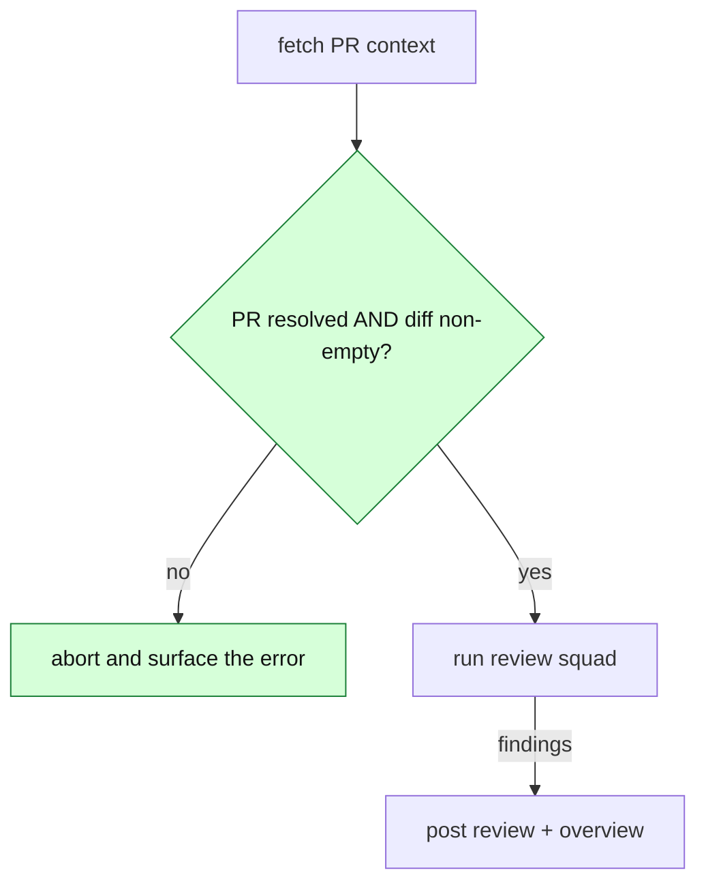

# Overview diagram — 1.0 production standard

The triage agent posts ONE overview comment per PR: a prose walkthrough + a single
```` ```mermaid ```` diagram of how the change works. The diagram is the PR overview —
**posted on PR-open, then edited in place** as the PR evolves (never re-posted; see the
overview-edit-in-place TODO in `CLAUDE.md`).

Tune the standard visually: `~/.claude/work/cc-review/overview-diagram-studio.html`
(open in a browser; it renders live and emits both the mermaid and this prompt block).

## The five rules

1. **Renders every time.** GitHub mermaid is strict and a block that fails to parse is
   worse than none. GitHub-safe subset: quote EVERY node label `["…"]`; never place raw
   `( ) < > # % { } |` or an unescaped `"` inside a label; no exotic/unsupported syntax.
2. **Show CALLS and DECISIONS, never a static box list.** Label edges with the actual
   call/message (`"enqueue(event)"`, `"context()"`); render every branch/guard as a
   flowchart diamond `{"condition?"}` or a sequence `alt`/`else`/`opt` block. *(Maintainer-
   critical: a fan-out of changed symbols is a bullet list in disguise — show the flow.)*
3. **Type chosen for the change**, not defaulted:
   - `sequenceDiagram` — cross-component / async call flows
   - `flowchart` — branching / control-flow logic
   - `stateDiagram-v2` — lifecycle / state machines
   - `classDiagram` — type / structure changes
   - `erDiagram` — schema / data-model changes
   - If the change has no real flow (independent edits), prefer prose over a forced catalog.
4. **Emphasize what the PR changes.** Tag new/modified/risky nodes and style them —
   `classDef chg fill:#d6ffd9,stroke:#1a7f37,color:#111` (or `risk fill:#ffd6d6,stroke:#cc1111`)
   then `class <ids> chg`; in sequence diagrams use `Note over …: NEW`.
5. **5–12 nodes, one clear story.** Collapse incidental detail.

## Prompt block (paste into `triagePrompt`, replacing the current diagram instruction)

```
DIAGRAM — inside overview_markdown, exactly one ```mermaid fenced block:
- Choose the type that fits THIS change, do not default blindly:
  sequenceDiagram (cross-component/async calls); flowchart (branching/control flow);
  stateDiagram-v2 (lifecycle/state); classDiagram (type/structure); erDiagram (schema).
  If the change has no real flow (independent edits), prefer prose over a forced catalog.
- Show CALLS and DECISIONS, never a static list of changed symbols: label edges with the
  actual call/message; render every branch/guard as a flowchart diamond {"condition?"} or
  a sequenceDiagram alt/else (or opt) block.
- Mark what the PR changes: tag new/modified hops and emphasize them with classDef
  (chg fill:#d6ffd9,stroke:#1a7f37; risk fill:#ffd6d6,stroke:#cc1111) + `class <ids> chg`,
  or in sequence diagrams a `Note over …: NEW`.
- RENDER-SAFE (GitHub is strict; a block that fails to parse is worse than none):
  quote EVERY node label ["…"]; never put raw ( ) < > # % { } | or an unescaped " inside a
  label; no exotic syntax.
- Keep it to 12 nodes max, one clear story; collapse incidental detail.
- On a re-run, if an overview diagram already exists, EDIT IT IN PLACE to match the current
  code; do not post a second overview.
```

## Worked examples (all copy-paste-valid GitHub mermaid)

Flowchart with a decision diamond (a guard change):



Sequence with labeled calls + an `alt` decision (a flow feature):


